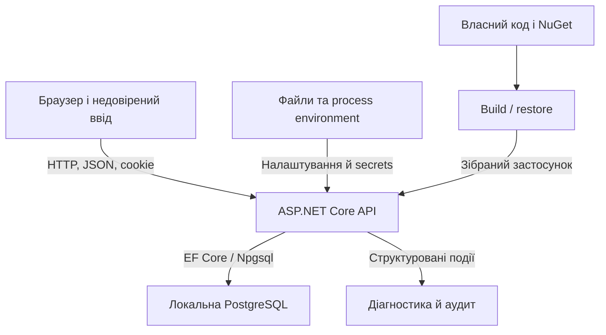

# Модель загроз SecureLab для лабораторної роботи №6

Автор: Тимошенко Андрій, КБ-41. Рівень: «Добре». Дати огляду: 08–09.11.2026. Review-start: `52793f68d948bc5cd81081b20969a3bc57798bcc`, початковий тег v0.5.0, гілка lab/6-hardening-review.

## Призначення й межі

Модель описує власний локальний трекер інцидентів: браузерний клієнт, ASP.NET Core API, Identity/cookie, PostgreSQL, конфігурацію, build/restore і логи. Її мета - визначити, яку властивість захищає кожен control та яким фактичним сценарієм вона перевіряється. Модель не претендує на повний penetration test або аналіз production-інфраструктури.

## Компоненти й потоки

Транспорт у штатному launch profile - http://localhost:5080; БД прив’язана до 127.0.0.1:54329. CORS probes на localhost:4173 і localhost:4174 мають інші origins, хоча є same-site. Cookie-aware tests використовують https://localhost у TestServer; це не перевірка реального TLS. Redis відсутній.

## Активи

| Актив | Що має зберігатися |
|---|---|
| Навчальні акаунти та auth-cookie | Автентичність сеансу, конфіденційність credential |
| Інциденти й коментарі | Цілісність content, контроль читання й зміни |
| Status та history | Лише дозволені переходи, правильний subject і час |
| Ролі й owner | Клієнт не призначає собі роль або іншого власника |
| Configuration secrets | Не потрапляють до tracked state, HTTP або логів |
| Доступність пошуку й login | Обмеження зловживання в межах одного API instance |
| Журнал аудиту | Можливість реконструювати дію без зайвих персональних даних |
| Відтворюваний код | Зрозумілий старт, lockfiles, перевірений commit і чесні межі доказу |

## Суб’єкти та довіра

Анонімний браузер може звертатися до публічних routes, але не має права доступу до protected incidents. Alice і Bob - Reporter: контент і права перевіряються щодо власного ресурсу; знання чужого Guid не надає доступу. Morgan - Analyst: може читати для аналізу та виконати дозволений New → Triaged, але право читання не дає довільного content update/delete. Admin має роль Administrator, однак повний аудит усіх адміністративних сценаріїв цією роботою не заявлено. Локальний розробник керує environment і reset лише на навчальному стенді. Текст із БД не вважається довіреним HTML.

## Точки входу

| Вхід | Недовірені значення / рішення |
|---|---|
| POST /api/auth/login | UserName, Password; уніфіковані auth-відмови, limiter |
| POST /api/auth/register | Реєстраційний DTO; роль задає сервер, не клієнт |
| POST /api/auth/logout | Auth-cookie і request token; спочатку antiforgery, потім SignOutAsync |
| GET /api/auth/csrf-token | Поточний principal; request token видається після входу |
| GET /api/incidents/search | q, sortBy; literal search, allowlist, search limiter |
| GET list/details/comments | Resource ID, filters; resource-based authorization |
| POST /api/incidents | DTO; власник/час/status формуються сервером |
| PUT /api/incidents/{id} | Title, Description; role/owner/status у body не надають прав |
| DELETE /api/incidents/{id} | Resource ID, auth-cookie, antiforgery; позитивне бізнес-видалення не доведено |
| POST /api/incidents/{id}/triage | ID, Note; потрібна роль і стан New |
| DOM rendering | Description, Comment.Text; лише текстові вузли |
| Startup і restore | Config, environment, package sources, lockfiles |
| Log sink | Structured fields, exceptions; не повний request/model dump |

## Межі довіри, загрози й перевірки

| Межа | Загроза | Control | Перевірка й результат |
|---|---|---|---|
| Браузер → mutation API | Запит із cookie без усвідомленої дії клієнта | Standard antiforgery cookie/request pair | REG-CSRF-01: missing/invalid 400, стан незмінний; valid 204 зі зміною |
| Cookie principal → ресурс | IDOR/BOLA | IncidentAuthorizationHandler і server-side owner/role checks | Чужі read/update відхиляються, state preservation assertions збережено |
| Reporter → privileged transition | Виконання triage без ролі | IncidentOperations.Triage і перевірка статусу | Alice 403, ресурс New; Morgan 204, Triaged; repeat409 |
| User input → SQL | Зміна структури пошукової умови/сортування | Параметризований LINQ/ILike, escaping, sort allowlist | S-02:200 []; T-04 USB/O'Brien200; T-05 invalid sort400 |
| БД/API → DOM | Stored XSS | textContent, renderPlainText, додаткова CSP | REG-XSS-01: 0 description children, comments без HTML children, marker null |
| Cross-origin JS → API response | Недозволене читання | Exact-origin CORS | 4173 readable; 4174 blocked; denied preflight не запускає GET |
| Endpoint → response | Витік exception details і зникнення headers | AddProblemDetails/UseExceptionHandler, OnStarting headers | Production safe500 із trace; після fix headers також на500 |
| Request stream → ресурс API | Надлишкові запити | Fixed-window search/login policies | Search 200/200/200/429, Bob200, recovery200; login401/401/429, recovery204 |
| Environment → API | Development налаштування в Production | Явний profile, no-launch-profile, окрема конфігурація | Console Production, OpenAPI404; тести підтвердили environment |
| Git/NuGet → build | Credential у коді, відома advisory | Контекстний secret search, NuGet audit | 164 класифіковані рядки; audit обох проєктів без findings |
| API → logs | Витік credentials, непридатний audit | Мінімальні structured fields і trace | Success/denied для одного resource; 5 пошуків дали0 |

## Стандартний token flow

1. Користувач проходить login та одержує authentication-cookie.
2. На першій mutation поточна сторінка звертається до protected GET /api/auth/csrf-token.
3. GetAndStoreTokens встановлює antiforgery-cookie за потреби й повертає request token у JSON; відповідь має no-cache/no-store.
4. Helper зберігає лише request token у пам’яті сторінки та додає X-CSRF-TOKEN до unsafe-запиту власного origin.
5. AntiforgeryFilter перевіряє пару. Невалідна пара завершується 400 Problem Details до бізнес-handler.
6. Після проходження antiforgery продовжують діяти DTO validation й authorization.
7. Після login/logout кеш очищується; після F5/переходу токен отримується lazy заново. Автоматичного retry mutation після4xx немає.

Login/register не включені до цього post-login flow, бо токен, доступний тільки після login, не може бути передумовою самого login. Ця відмінність задокументована як залишковий ризик, а не як автоматичний захист.

## Відтворюваний старт

Відправна точка - власний v0.5.0 із commit 52793f68d948bc5cd81081b20969a3bc57798bcc. Потрібні .NET SDK10.0.302, PowerShell, Docker Compose і локальна БД. SeedUsers__Password задається поза Git. Перед reset/tests API зупиняється. Reset очищує навчальні дані й дозволений лише в Development; після reset попередні випадкові fixture IDs можуть бути відсутні, тому нові ресурси створюються заново й отримані Guid записуються як фактичні.

Стартові команди: dotnet restore SecureLab.sln --locked-mode; dotnet build SecureLab.sln -c Release --no-restore; docker compose --env-file infra/.env.example -f infra/compose.yaml up -d --wait; dotnet test SecureLab.sln -c Release. Development-запуск: dotnet run --project src/SecureLab.Api. Health перевіряється окремим GET /health і має повертати200/ready.

## Підтверджені fixture IDs

XSS Description: 07caeca4-957a-4a58-ab3b-db152c7291c7. Seed parent із marker-коментарем: 20000000-0000-0000-0000-000000000001. Marker comment: 30000000-0000-0000-0000-000000000005. Audit resource: 0a0d3fbc-8d67-4ca8-adcb-703d762e8941. Це фактичні навчальні ідентифікатори з виконаного прогону, а не гарантія їх наявності після наступного reset.

## Виключення та residual risks

Реальна інфраструктура, TLS termination, сертифікати, Host filtering deployment, секрети зовнішніх CI, історія/stash/інші клони, повний аналіз залежностей поза NuGet та distributed rate limiting не перевірялися. Відкриті credentials локальної БД прийнятні лише в documented study-only loopback-контексті. Log review охоплює конкретні сценарії та один sink. DELETE denial не доводить фізичного видалення. Фактичну відмову Production reset окремо ще не відтворено. Фінальний commit/tag і final regression ще потрібно завершити.
